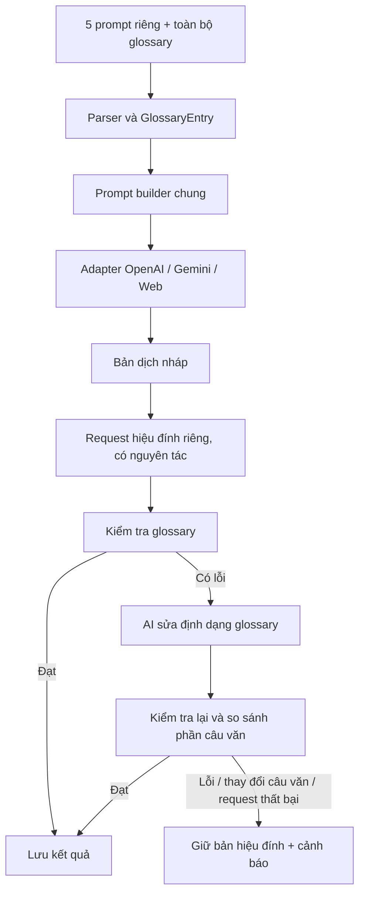

# Nâng cấp Glossary và pipeline dịch

## Kiến trúc đã kiểm tra

- Bản local: Python, HTTP server trong `server/`, dịch vụ trong `services/`, giao diện JavaScript trong `web/`. Launcher Windows khởi động backend này.
- Bản chạy độc lập: React/TypeScript/Vite trong `web-client/`, lưu dự án bằng IndexedDB; gọi Gemini trực tiếp.
- Dữ liệu local: `context.json` giữ bốn prompt vai trò/nhiệm vụ và `style_notes` là prompt văn phong thứ năm. Glossary nằm trong `glossary.txt`. Không gộp các trường cấu hình này.
- Luồng local: `cores/translation/runner.py` → `stage.py` → `cores/stages/runtime.py` → adapter trong `providers/`. Hậu dịch dùng `cores/postprocess/`. Streaming Gemini và nhập bản dịch thủ công dùng lại runner/hậu dịch hiện có.
- Cấu hình provider/model dịch và hiệu đính đã độc lập qua `pipeline_translate_*`, `pipeline_polish_*`. Correction dùng chính provider/model hiệu đính; không cần cấu hình công đoạn thứ ba.



Các bước xét sót ngoại ngữ, cập nhật xưng hô, review nền và R19 hiện có vẫn được tích hợp. Glossary được kiểm tra sau bước xét sót ngoại ngữ. Validator không thay thế chuỗi trong bản dịch.

## Parser và tương thích

```text
Lucid = Lucid
Chain of Heart = Xiềng Xích Trái Tim | type=Skill | first_vi=yes | first_en=no | brackets=yes
```

Entry không có metadata giữ hành vi dịch nguồn → đích cũ. Đây là quyết định tương thích quan trọng: các mục cũ như `旧 = Cũ` vẫn dịch thành `Cũ`. Các cờ boolean mặc định là `false`; cờ `extended` phân biệt mục cũ với mục có quy tắc hiển thị metadata.

`first_vi` và `first_en` ngang ưu tiên nhưng loại trừ nhau. Entry có metadata áp dụng sáu trường hợp:

| first_vi | first_en | brackets | Lần đầu trong chương | Lần sau |
| --- | --- | --- | --- | --- |
| yes | no | yes | `[English] (Vietnamese)` | `[English]` |
| yes | no | no | `English (Vietnamese)` | `English` |
| no | yes | yes | `[Vietnamese] (English)` | `[Vietnamese]` |
| no | yes | no | `Vietnamese (English)` | `Vietnamese` |
| no | no | no | `English` | `English` |
| no | no | yes | `[English]` | `[English]` |

`type=Common` hoặc `target_only=yes` ưu tiên cao hơn ba cờ trên và luôn chỉ xuất đích tiếng Việt thuần.

Không tạo chú giải trùng như `Lucid (Lucid)`, kể cả khi hai vế của entry giống nhau. Tiêu đề chương, glossary, ví dụ, prompt và tài liệu tham khảo không được tính là lần xuất hiện trong nội dung truyện.

Parser chia tại dấu `=` đầu tiên và phân tách metadata bằng `|`, trim khoảng trắng, hỗ trợ Unicode/BOM, comment `#`, boolean yes/no/true/false không phân biệt hoa thường. Dòng thiếu nguồn/đích bị bỏ qua kèm warning; boolean sai trở về false. Khóa trùng dùng mục hợp lệ cuối cùng và warning. Các type chuẩn được chuẩn hóa; type mới và trường lạ vẫn được giữ. `extra_metadata` giữ được `priority`, `canonical` và các trường bổ sung qua load/edit/save.

Editor của cả hai giao diện có nguồn, đích, type và các checkbox `target_only`, `first_vi`, `first_en`, `brackets`. Editor TXT/JSON, import và export giữ metadata. API lưu editor cũ chỉ gửi nguồn/đích vẫn giữ metadata hiện có của cùng key. Khi AI sinh glossary mới bỏ metadata của một key cũ, luồng merge giữ metadata cũ.

## Prompt builder và provider

Quy tắc dùng chung nằm trong `defaults/glossary_rules.txt`; cả backend Python và web client đọc cùng tệp. Python `PromptText` mang system/user riêng, đồng thời có biểu diễn chuỗi để tương thích log, dịch thủ công và provider Web.

- Dịch: system = vai trò dịch + văn phong + glossary rules; user = nhiệm vụ dịch + glossary đầy đủ + nguyên tác + ngữ cảnh hiện có.
- Hiệu đính: system = vai trò hiệu đính + văn phong + glossary rules; user có nhiệm vụ hiệu đính, glossary, nguyên tác và bản nháp.
- Correction: yêu cầu chỉ sửa lỗi thuật ngữ được liệt kê, có glossary và nguyên tác. Bản sửa chỉ được nhận nếu validator đạt và phần câu văn ngoài glossary được bảo toàn.
- OpenAI Responses: system đưa vào `instructions`, user vào `input`. Gemini Generate Content và Interactions: chuyển sang `system_instruction`. Provider Web nhận bản ghép đầy đủ vì giao diện chỉ có một ô nhập.
- System prompt tùy chỉnh của web client được bổ sung vào prompt; không làm mất năm prompt và glossary rules.

Request mẫu được sinh bằng code thật, không gọi API:

- [Dịch](examples/translation_request.json)
- [Hiệu đính](examples/proofreading_request.json)
- [Correction](examples/correction_request.json)

Tạo lại: `.venv\Scripts\python.exe -X utf8 docs/examples/build_requests.py`.

Mapping API được đối chiếu bằng OpenAI Docs — [Responses](https://developers.openai.com/api/reference/typescript/resources/beta/subresources/responses/methods/create) và [Gemini text generation](https://ai.google.dev/gemini-api/docs/text-generation).

## Context và chương chia đoạn

Mặc định gửi toàn bộ glossary. `load_context_text(raw_text=...)` vẫn giữ API lọc tường minh cũ cho caller cần nó; runner dịch tự động gọi bản không lọc. Chọn tên nhân vật cho bộ nhớ xưng hô vẫn có bộ lọc riêng.

Trước request dịch/hiệu đính, hệ thống ước lượng system, user, tài liệu đính kèm và phần dành cho output. Ngân sách context mặc định bảo thủ là 128.000 token; chỉnh theo model ở Cài đặt. Đây không phải tuyên bố rằng mọi model có context 128.000 token. Bản local có `translate_context_tokens` và `polish_context_tokens`; web client có ngân sách theo tác vụ.

Chỉ khi ước lượng vượt ngân sách mới lọc glossary theo nguyên tác/bản nháp, giữ các alias liên kết và mục chung đích. Nếu vẫn không vừa, luồng dịch tự động chia tại ranh giới đoạn/câu/khoảng trắng, giữ mọi ký tự nguồn. Cũng chia khi ước lượng bản dịch có thể vượt giới hạn output. Có giới hạn độ sâu chia, không cắt bỏ đoạn nguồn để request vừa.

Bản local giữ từng cặp nguồn/nháp để hiệu đính đúng phần nguyên tác. Trạng thái thuật ngữ của hiệu đính được tạo lại độc lập với dịch, cập nhật tuần tự sau mỗi đoạn. Chương mới bắt đầu với state rỗng. Validator nhận diện các heading Chapter/Chương/SECTION kèm số, reset theo từng chương; ưu tiên term dài để tránh nhận `Heart` nằm trong `Chain of Heart`.

## Failure handling và báo cáo

- Dịch lỗi không chạy hiệu đính. Giữ cơ chế retry chương hiện có; lỗi context không được retry như lỗi mạng.
- Output dịch/hiệu đính phải đủ TITLE/CONTENT/END, có tiêu đề/nội dung thật. OpenAI/Gemini bị cắt output không được coi là hoàn tất.
- Retry Gemini độc lập giới hạn bốn lần. Chế độ retry theo chương vẫn giao việc đếm lần thử cho runner. Hiệu đính và correction không mắc vào vòng retry lồng vô hạn.
- Correction có giới hạn, lỗi hoặc response rỗng không ghi đè bản hiệu đính. Bản sửa còn lỗi hoặc thay đổi câu văn ngoài glossary cũng bị từ chối.
- Local lưu `glossary_validation.json` trong dự án theo chapter ID, kèm errors/corrected và cảnh báo context hiệu đính nếu có. API logs ghi riêng correction.
- Web client lưu trạng thái kiểm tra theo chương trong IndexedDB và hiển thị lỗi khi mở chương đó.

## Kiểm thử

- Toàn bộ unittest Python: **384 test đạt**.
- Toàn bộ Vitest web client: **56 test đạt**, 9 tệp test.
- TypeScript `tsc -b`: đạt.
- Vite production build: đạt; còn cảnh báo kích thước bundle lớn hơn 500 kB.
- Test mới bao phủ parser cũ/mới, Unicode, boolean, dữ liệu lỗi, duplicate, metadata lạ, import/edit/save, năm prompt, mapping API/Web, full glossary, fallback alias, bốn kiểu hiển thị, reset nhiều chương, trạng thái chunk, pipeline Gemini → OpenAI, correction thất bại và bảo toàn câu văn.
- Sửa một lỗi test có sẵn trên Windows: subprocess đọc output UTF-8 của entrypoint bằng đúng encoding. Các assertion R19/prompt được cập nhật để kiểm tra cả system và user sau khi tách cấu trúc request.
- Kiểm thử import từng module trong tiến trình mới phát hiện và xác nhận đã sửa vòng import giữa prompt builder và runtime. Model request nằm trong module không phụ thuộc runtime.
- Không gọi API thật trong đợt kiểm thử; không sử dụng khóa API để đánh giá chất lượng bản dịch thực tế.

Lệnh tương đương đã chạy (gọi trực tiếp Node vì npm shim trên máy gặp lỗi quyền đọc đường dẫn):

```powershell
.venv\Scripts\python.exe -X utf8 -m unittest discover -s tests
node web-client/node_modules/vitest/vitest.mjs run --root web-client
# Chạy hai lệnh sau trong web-client:
node node_modules/typescript/bin/tsc -b
node node_modules/vite/bin/vite.js build
```

## Files changed trong lần nâng cấp này

| Nhóm | Tệp |
| --- | --- |
| Glossary | `cores/context/glossary.py`, `merge.py`, `selection.py`, `storage.py`, `rules.py`, `validation.py`; `defaults/glossary_rules.txt` |
| Prompt và request | `cores/translation/prompts.py`, `request.py`, `context.py`, `stage.py`, `runner.py`; `cores/stages/budget.py`, `runtime.py`, `transport.py`, `outputs.py` |
| Hậu dịch | `cores/postprocess/glossary.py`, `pipeline.py`, `polish.py`, `language_check.py`, `__main__.py`; `cores/r19/masking.py` |
| Adapter/API | `providers/base.py`, `gemini_api.py`, `openai_api.py`, `openai_client.py`; `cores/gemini/api_client.py`, `runtime.py` |
| Dịch vụ/UI local | `services/context/service.py`, `services/settings_schema.py`; `web/features/project-memory.js`, `settings.js`, `web/terminology.css` |
| Web client | `web-client/src/App.tsx`, `types.ts`, `styles/app.css`, `services/glossary.ts`, `requestBudget.ts`, `gemini.ts`, `localProjectArchive.ts`; `web-client/vite.config.ts`, `README.md` |
| Test | `tests/test_glossary_metadata.py`, `test_glossary_pipeline.py`, `test_entrypoint_imports.py`, `test_gemini_runtime.py`, `test_r19_translation.py`; `web-client/src/services/glossary.test.ts`, `gemini.test.ts` |
| Tài liệu | Báo cáo này và `docs/examples/` |

Workspace đã có thay đổi trước khi bắt đầu. Danh sách trên chỉ mô tả phạm vi nâng cấp này, không nhận các thay đổi có sẵn là công việc mới.

## Giới hạn còn lại

- Validator kiểm tra cấu trúc, spelling và các dấu hiệu thay canonical bằng tiếng Việt; không chứng minh được đúng nghĩa, toàn vẹn nội dung hoặc phân biệt mọi từ thông thường với thuật ngữ. Những phần này vẫn cần model hiệu đính và kiểm tra người dùng.
- `canonical` được lưu/gửi cho AI và dùng giữ liên kết alias khi lọc; chưa có bộ phân giải alias ngữ nghĩa riêng.
- Ước lượng token dựa trên byte UTF-8, không dùng tokenizer/countTokens chính xác của từng model. Đặt ngân sách theo model thực tế. Một đoạn không có ranh giới chia an toàn, hoặc riêng prompt/tài liệu tham khảo đã quá lớn, sẽ báo lỗi thay vì cắt nguồn.
- Hiệu đính một bản dịch cũ quá lớn, không có cặp chunk nguồn/nháp đã tạo trong luồng tự động, có thể vượt ngân sách; bản cũ được giữ để tăng context hoặc chia lại có kiểm soát.
- Kiểm tra bảo toàn câu văn của correction cố ý chặt: một sửa đổi cần đổi cả câu hoặc chú giải không nhận diện được có thể bị từ chối và cần sửa tay. Không tự ghi đè bản hiệu đính bằng một ứng viên không chắc chắn.
- Web client độc lập tiếp tục chỉ hỗ trợ Gemini như trước. Cấu hình trộn OpenAI/Gemini/Web và các adapter mở rộng nằm trong bản local.
