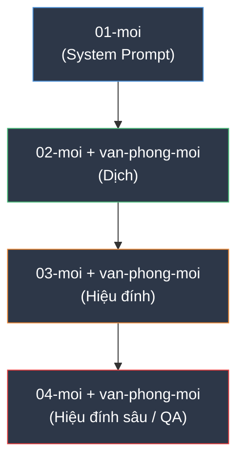

# Phân Tích & Đánh Giá Bộ 5 Prompt Dịch Thuật OJE

> Vai trò: Chuyên gia kiểm thử prompt  
> Mục tiêu đánh giá: Dịch phóng tác, tái cấu trúc văn khi có nhiều câu văn đơn  
> Đối tượng: [01-moi.md](file:///d:/Aiko-App-Translator-v1.2.2/truyen/OJE/01-moi.md), [02-moi.md](file:///d:/Aiko-App-Translator-v1.2.2/truyen/OJE/02-moi.md), [03-moi.md](file:///d:/Aiko-App-Translator-v1.2.2/truyen/OJE/03-moi.md), [04-moi.md](file:///d:/Aiko-App-Translator-v1.2.2/truyen/OJE/04-moi.md), [van-phong-moi.md](file:///d:/Aiko-App-Translator-v1.2.2/truyen/OJE/van-phong-moi.md)

---

## 1. Tổng Quan Kiến Trúc Hệ Thống Prompt

| Prompt | Vai trò | Dung lượng | Đối tượng sử dụng |
|--------|---------|------------|-------------------|
| **01-moi** (System) | System prompt — thiết lập vai trò, nguyên tắc nền, glossary | ~15 KB, 134 dòng | Toàn bộ pipeline |
| **02-moi** (Dịch) | Prompt dịch chính — hướng dẫn chi tiết cách dịch từng chunk | ~47 KB, 528 dòng | Bước dịch (translate) |
| **03-moi** (Hiệu đính) | Prompt hiệu đính — đối chiếu bản dịch với nguyên tác | ~11 KB, 89 dòng | Bước hiệu đính (edit) |
| **04-moi** (Hiệu đính sâu) | Prompt hiệu đính chi tiết — kiểm tra toàn diện | ~33 KB, 333 dòng | Bước hiệu đính sâu (QA) |
| **van-phong-moi** (Văn phong) | Style guide — quy tắc văn phong xuyên suốt | ~44 KB, 468 dòng | Cả dịch lẫn hiệu đính |

### Sơ đồ luồng sử dụng



---

## 2. Đánh Giá Tổng Thể

### 2.1 Điểm mạnh nổi bật

> [!TIP]
> Bộ prompt này thuộc hạng **xuất sắc** về mặt thiết kế prompt cho dịch thuật văn học. Rất ít bộ prompt dịch thuật đạt được mức chi tiết và sự tinh tế này.

**① Khung "Phóng tác có kiểm soát" — Thiết kế lõi rất mạnh**

Sự phân tách giữa **dữ kiện cứng** (bất khả xâm phạm) và **lớp diễn đạt mềm** (tự do sáng tạo) là một thiết kế prompt engineering xuất sắc. Nó giải quyết được bài toán cổ điển trong dịch thuật: làm sao cho phép AI sáng tạo mà không bịa thêm nội dung.

- Dữ kiện cứng được liệt kê cụ thể (sự kiện, chủ thể, trình tự, con số, phủ định, mức độ mơ hồ…)
- Lớp mềm cũng được định nghĩa rõ (nhịp câu, liên kết, hình ảnh, khoảng lặng…)
- **Bốn cổng kiểm soát** cho mọi chi tiết mở rộng: phù hợp nguồn, không tạo hệ quả, đúng điểm nhìn, đúng tông

**② Hệ thống ví dụ phong phú và đa chiều**

Cả bộ prompt chứa hơn **40 ví dụ cụ thể** (A-V trong 02, ví dụ 0-M trong van-phong, các ca đối chiếu trong 04), mỗi ví dụ đều:
- Có context rõ (chương nào, nhân vật nào, loại cảnh gì)
- Có cả bản "nên" và "tránh"
- Giải thích **lý do** đằng sau quyết định

Đây là điểm vượt trội so với đa số prompt dịch thuật chỉ nêu nguyên tắc trừu tượng.

**③ Xử lý ranh giới câu — Giải quyết đúng vấn đề cốt lõi**

Đối với mục tiêu "tái cấu trúc văn khi có nhiều câu văn đơn", bộ prompt thiết kế:
- **Cổng quyết định** trước khi giữ/nối câu ngắn (02 dòng 234-238, 04 dòng 107-111)
- **Danh sách KHÔNG ÉP GHÉP** (combat beat, punchline, reveal, interruption…)
- **Danh sách NÊN NỐI** (động tác liên tục, đặc điểm cùng đối tượng, bổ ngữ rời…)
- Nguyên tắc "bảo tồn chức năng, không bảo tồn hình dạng"

**④ Voice routing chi tiết cho từng nhân vật**

Van-phong-moi chứa profile giọng riêng cho 8 nhân vật (Lucid, Ayame, Frederick, Elara, Alice, Mary, Pilt, Mira), với:
- Register và nhịp riêng
- "Ngôn ngữ hiểu thế giới" đặc trưng (Lucid nghĩ bằng lựa chọn/biến số, Pilt nghĩ bằng giao dịch/giá cả…)
- Thang phóng tác 0-10 theo nhân vật và loại cảnh

**⑤ Bảng tỷ lệ dung lượng theo loại cảnh**

Mục tiêu dung lượng cụ thể (02 dòng 186-192) là một công cụ biên tập thực tế:
- System/danh sách: ~1.20-1.55× 
- Đối thoại nhanh: ~1.70-2.05×
- Miêu tả/nội tâm: ~2.45-3.20×
- Chunk hỗn hợp: ~1.95-2.30×, trung tâm 2.05×

---

### 2.2 Vấn đề cần lưu ý

#### 🔴 Vấn đề 1: Dung lượng prompt cực lớn — Rủi ro "attention dilution"

| Prompt | Tokens ước tính |
|--------|----------------|
| 01-moi | ~5,500 |
| 02-moi | ~17,500 |
| 03-moi | ~4,200 |
| 04-moi | ~12,200 |
| van-phong-moi | ~16,200 |

> [!WARNING]
> **Tổng hợp khi dịch:** 01 + 02 + van-phong ≈ **39,200 tokens** chỉ riêng prompt (chưa tính glossary, xưng hô, ngữ cảnh và nội dung cần dịch).
> 
> **Tổng hợp khi hiệu đính sâu:** 01 + 04 + van-phong ≈ **33,900 tokens**.

Đây là mức **rất cao**. Các vấn đề có thể xảy ra:
- **Lost in the Middle:** Model có xu hướng ghi nhớ tốt phần đầu và cuối prompt, nhưng "quên" phần giữa. Với 02-moi dài 528 dòng, các quy tắc ở giữa (mục 4-6) có nguy cơ bị suy giảm attention.
- **Instruction interference:** Khi cùng một chủ đề (ví dụ: nối câu) được nhắc ở 3 nơi khác nhau (01, 02, van-phong), model có thể tạo ra hành vi "trung bình hóa" thay vì tuân thủ chặt một quy tắc.
- **Context window pressure:** Nếu đoạn cần dịch dài + glossary lớn, tổng input có thể chiếm 60-70% context window, ảnh hưởng đến chất lượng output.

#### 🔴 Vấn đề 2: Trùng lặp nội dung nghiêm trọng giữa các prompt

Phân tích overlap:

| Chủ đề | Xuất hiện trong |
|--------|----------------|
| Định nghĩa dữ kiện cứng vs. lớp mềm | 01 (L9-15), 02 (L5-18), 03 (L10), 04 (L5-14), van-phong (L6-9) — **5/5 prompt** |
| Bốn cổng kiểm soát | 01 (L17-24), 02 (L20-27), 03 (L22), 04 (L14), van-phong (L11-16) — **5/5** |
| Ranh giới câu / nối vs. giữ | 01 (L62-100), 02 (L55-251), 03 (L36-40), 04 (L65-176), van-phong (L58-95) — **5/5** |
| Ví dụ "immaculate" / "feverish glow" / "gore" | 01 (L51-58), 02 (L35-42), 04 (L51-57), van-phong (L144) — **4/5** |
| Glossary & thuật ngữ | 01 (L120-129), 02 (L465-488), 03 (L74-85), 04 (L271-303), van-phong (L431-445) — **5/5** |
| Điểm nhìn / POV | 01 (L105-118), 02 (L455-463), 03 (L32-33,44), 04 (L247-263), van-phong (L269-278) — **5/5** |
| Giọng nhân vật (Lucid/Ayame/Frederick) | 01 (L113-118), van-phong (L210-267) — **2/5** |
| Ví dụ "orphanage burning" | 02 (L153-167, 300-302), 04 (L203), van-phong (L72) — **3/5** |
| Ví dụ "He drew. Discarded." | 02 (L339-341), 04 (L180-181) — **2/5** |

> [!IMPORTANT]
> **~60-70% nội dung bị lặp** qua các prompt. Điều này không chỉ lãng phí token mà còn tạo **xung đột tiềm ẩn** khi cùng một quy tắc được diễn đạt hơi khác nhau ở các nơi.

#### 🟡 Vấn đề 3: Xung đột / mâu thuẫn tiềm ẩn giữa các chỉ dẫn

**Xung đột 1: "Giữ nguyên" vs. "Tái cấu trúc"**

- 03-moi (L18): *"Nếu một cụm đã đúng nghĩa, đủ ý, rõ chủ thể và tự nhiên, giữ cách tổ chức của nó"*
- 02-moi (L7): *"Bản đúng ngữ pháp nhưng chỉ báo cáo sự kiện, còn cú pháp Anh hoặc bỏ qua vùng giải nén hợp lệ vẫn cần biên tập"*
- van-phong (L1): *"mở rộng mạnh lớp diễn đạt mềm"*

Model có thể nhận tín hiệu hỗn hợp: bảo vệ bản nháp (03) vs. chủ động mở rộng (02, van-phong). Đặc biệt khi 03 nói "giữ cách tổ chức" nhưng van-phong nói "chủ động tái cấu trúc".

> **Tác động thực tế:** Model hiệu đính (dùng 03) có xu hướng **quá bảo thủ** — giữ nguyên những đoạn vụn vì "đúng nghĩa, đủ ý". Trong khi prompt dịch (02) lại yêu cầu mạnh mẽ hơn về tái cấu trúc.

**Xung đột 2: Dung lượng mục tiêu**

- 02-moi (L186-206): Bảng tỷ lệ cụ thể, "dưới 1,90 là tín hiệu bắt buộc rà"
- 03-moi: **Không nhắc đến dung lượng mục tiêu**
- 04-moi (L317): "dưới 1,90 cần rà" nhưng cũng "tuyệt đối không nhân độ dài bản nháp lên lần nữa"
- van-phong (L340): Lặp lại bảng tỷ lệ

Bước hiệu đính (03) hoàn toàn thiếu chỉ dẫn về dung lượng, có thể dẫn đến model cắt bớt phần mở rộng hợp lệ mà bước dịch (02) đã tạo ra.

**Xung đột 3: Mức độ chi tiết voice routing**

- 01-moi: Chỉ có 4 ví dụ giọng nhân vật (Jing Xiu, Lucid, Ayame, Fenwick)
- van-phong: Có **router chi tiết 8 nhân vật** + thang phóng tác 0-10

Khi prompt 01 được dùng làm system prompt, nó có thể "neo" model vào 4 ví dụ giọng cụ thể — trong khi van-phong muốn một hệ thống phức tạp hơn. Nếu model ưu tiên system prompt (hành vi thường thấy), router trong van-phong có thể bị suy giảm.

#### 🟡 Vấn đề 4: Quá nhiều "cổng quyết định" — Decision fatigue

Trong quá trình dịch, model phải đồng thời tuân thủ:
1. 4 cổng kiểm soát cho phần mở rộng
2. Cổng quyết định ranh giới câu ("chức năng nghệ thuật hay cú pháp Anh?")
3. 10 mục trong danh sách KHÔNG ÉP GHÉP
4. 7+ mục trong danh sách NÊN NỐI
5. 3 lượt tự biên tập
6. Bảng tỷ lệ dung lượng 7 loại cảnh
7. Thang phóng tác 12 mức
8. 10+ mục kiểm tra sau tái cấu trúc
9. Router 8 nhân vật
10. Glossary Formatting Rules

> [!CAUTION]
> Tổng cộng có khoảng **50+ quy tắc cần đồng thời kiểm tra** ở mỗi cụm câu. Ngay cả model mạnh nhất cũng khó đảm bảo tuân thủ tất cả. Thực tế, model sẽ **tự ưu tiên ngầm** — và thứ tự ưu tiên đó không nhất thiết khớp với ý bạn.

#### 🟡 Vấn đề 5: Prompt 03-moi quá ngắn so với nhiệm vụ

03-moi chỉ dài 89 dòng (~4,200 tokens) — **gấp 4 lần ngắn hơn** prompt dịch (02) và prompt hiệu đính sâu (04). Trong khi đó, hiệu đính là bước đòi hỏi:
- Đối chiếu song ngữ
- Phát hiện lỗi nghĩa
- Tái cấu trúc câu vụn
- Bảo vệ phóng tác hợp lệ
- Xử lý glossary

Sự mỏng của 03 có thể dẫn đến:
- Hiệu đính quá bảo thủ (giữ nguyên quá nhiều)
- Hoặc ngược lại: thiếu guardrail, sửa lan man

---

## 3. Đánh Giá Từng Prompt Chi Tiết

### 3.1 [01-moi.md](file:///d:/Aiko-App-Translator-v1.2.2/truyen/OJE/01-moi.md) — System Prompt

| Tiêu chí | Đánh giá | Ghi chú |
|-----------|----------|---------|
| Vai trò & identity | ⭐⭐⭐⭐⭐ | Xác định rõ: dịch giả + biên tập viên + tác giả chuyển thể |
| Nguyên tắc nền | ⭐⭐⭐⭐⭐ | Khung cứng/mềm + 4 cổng rất chặt |
| Bản sắc tác phẩm | ⭐⭐⭐⭐ | OJE identity rõ, 5 trục phong cách hay |
| Độ cô đọng | ⭐⭐⭐⭐ | Hợp lý cho system prompt |
| Rủi ro neo sai | ⭐⭐⭐ | 4 ví dụ giọng nhân vật có thể tạo neo quá sớm |

**Vấn đề cụ thể:**
- Mục "NGUYÊN TẮC VỀ RANH GIỚI CÂU" (L62-100) dài ~38 dòng — chiếm ~28% prompt. Đối với system prompt, phần này nên ngắn hơn và để chi tiết ở prompt nhiệm vụ.
- Ví dụ ở L84-87 rất cụ thể (chương 171, 201, 161, 160) — system prompt nên ở mức nguyên tắc, không nên có case study.

---

### 3.2 [02-moi.md](file:///d:/Aiko-App-Translator-v1.2.2/truyen/OJE/02-moi.md) — Prompt Dịch

| Tiêu chí | Đánh giá | Ghi chú |
|-----------|----------|---------|
| Hướng dẫn tái cấu trúc | ⭐⭐⭐⭐⭐ | Cực kỳ chi tiết: cổng quyết định, ví dụ A-V, nguyên tắc mặc định |
| Bảng tỷ lệ dung lượng | ⭐⭐⭐⭐⭐ | Thực tế, có thang theo loại cảnh |
| Ví dụ minh họa | ⭐⭐⭐⭐⭐ | 22 ví dụ A-V, đa dạng tình huống |
| Độ dài | ⭐⭐ | 528 dòng, ~47KB — quá dài, rủi ro attention dilution |
| Cấu trúc | ⭐⭐⭐ | 12 mục nhưng logic flow không hoàn toàn tuyến tính |
| Trùng lặp nội bộ | ⭐⭐ | Nhiều chỗ lặp ý với nhau ngay trong cùng file |

**Vấn đề cụ thể:**

**a) Lặp nội bộ trong 02:**
- L57-59 nói về 3 câu ngắn liên tiếp → L89-100 nói lại nguyên tắc mặc định tái cấu trúc → L504-517 lại là checklist "kiểm tra dấu vết sentence-by-sentence"
- Ý "không chỉ thay dấu chấm bằng dấu phẩy" xuất hiện ở L112-118, rồi lặp lại bản chất ở L258 và L76 của van-phong

**b) Mục "XÁC ĐỊNH ĐƠN VỊ Ý TRƯỚC KHI GOM" (L169-181):** Đây là phần dày nhất (12 bullet points phức tạp) nhưng lại nằm giữa prompt — vùng attention yếu nhất. Nên đưa lên sớm hơn hoặc biến thành checklist cuối.

**c) Phần "BA LƯỢT TỰ BIÊN TẬP" (L208-213):** Yêu cầu model thực hiện 3 lượt rà trước khi xuất. Về mặt prompt engineering, model LLM không thực sự "lặp" qua output 3 lần — nó sinh text tuần tự. Quy tắc này hoạt động như một **priority list** hơn là quy trình thực tế, nhưng cách diễn đạt có thể khiến model cố gắng "tốt ở mọi mặt" mà không ưu tiên rõ ràng.

---

### 3.3 [03-moi.md](file:///d:/Aiko-App-Translator-v1.2.2/truyen/OJE/03-moi.md) — Prompt Hiệu Đính

| Tiêu chí | Đánh giá | Ghi chú |
|-----------|----------|---------|
| Xác định vai trò | ⭐⭐⭐⭐ | Rõ: biên tập viên hiệu đính, không dịch lại |
| Nguyên tắc "sửa trên bản nháp" | ⭐⭐⭐⭐⭐ | Tránh được bẫy "dịch lại từ đầu" |
| Ví dụ | ⭐⭐⭐ | Chỉ 3 ví dụ (L52-54), ít hơn nhiều so với 02/04 |
| Hướng dẫn tái cấu trúc | ⭐⭐⭐ | Có nhưng mỏng, phụ thuộc van-phong |
| Cân bằng bảo thủ vs. mạnh tay | ⭐⭐⭐ | L62-64 cố gắng cân bằng nhưng chưa đủ rõ |
| Dung lượng mục tiêu | ⭐ | **Hoàn toàn thiếu** |

> [!WARNING]
> **03-moi là prompt yếu nhất trong bộ.** Nó quá ngắn để làm nhiệm vụ hiệu đính phóng tác — đặc biệt khi mục tiêu là tái cấu trúc câu vụn. Prompt này có xu hướng khiến model **quá bảo thủ**: giữ nguyên cấu trúc câu tiếng Anh vì "đã đúng nghĩa".

**Vấn đề cốt lõi:** 
- L18 nói "giữ cách tổ chức" nếu "đúng nghĩa, đủ ý" — nhưng **đúng nghĩa ≠ tốt về văn phong**, và prompt không nhấn mạnh đủ điểm này.
- Không có bảng tỷ lệ dung lượng → model hiệu đính có thể cắt bớt phần mở rộng mà bước dịch đã thêm.
- Phần tái cấu trúc câu chỉ được nêu trong 2 bullet points (L36-39), quá mỏng so với 02-moi dành ~200 dòng cho chủ đề này.
- L14 nói "chủ động mở rộng lớp mềm khi có căn cứ" nhưng không đưa cơ chế/ví dụ cụ thể nào để hướng dẫn HOW.

---

### 3.4 [04-moi.md](file:///d:/Aiko-App-Translator-v1.2.2/truyen/OJE/04-moi.md) — Prompt Hiệu Đính Sâu

| Tiêu chí | Đánh giá | Ghi chú |
|-----------|----------|---------|
| Cấu trúc checklist | ⭐⭐⭐⭐⭐ | 10 mục kiểm tra rõ ràng, có thứ tự ưu tiên |
| Ca đối chiếu thực tế | ⭐⭐⭐⭐⭐ | Ví dụ "immaculate", "gore", "feverish glow" rất thực tế |
| Xử lý câu vụn | ⭐⭐⭐⭐ | Mục 3 + 3.1 + 3.2 + 3.3 + 3.4 rất chi tiết |
| Dung lượng | ⭐⭐⭐ | 333 dòng — dài nhưng hợp lý hơn 02 |
| Trùng lặp với 02 | ⭐⭐ | ~50-60% nội dung overlap |
| Quan hệ với 03 | ⭐⭐ | Không rõ khi nào dùng 03, khi nào dùng 04 |

**Điểm mạnh nổi bật:**
- Mục "3.1. KIỂM TRA DẤU VẾT DỊCH TỪNG CÂU" (L91-127) là một trong những phần hay nhất trong toàn bộ hệ thống prompt — nó dạy model nhận diện "chuỗi câu tiếng Anh được thay bằng từ tiếng Việt" mà không chỉ dựa vào độ dài câu.
- "Cổng quyết định" (L107-111) ngắn gọn và dễ áp dụng hơn phiên bản trong 02.
- Ví dụ 1-5 (L180-196) cực kỳ sắc bén: "She could handle herself. Probably." → bản bỏ "Probably" vs. bản giữ.

**Vấn đề:**
- Nhiều ví dụ trùng với 02 (orphanage, drew/discarded, push himself up…)
- Mối quan hệ với 03 chưa rõ: 04 dài gấp 3.7 lần 03 nhưng cùng làm hiệu đính

---

### 3.5 [van-phong-moi.md](file:///d:/Aiko-App-Translator-v1.2.2/truyen/OJE/van-phong-moi.md) — Style Guide

| Tiêu chí | Đánh giá | Ghi chú |
|-----------|----------|---------|
| Character voice | ⭐⭐⭐⭐⭐ | 8 nhân vật, mỗi người có "ngôn ngữ hiểu thế giới" riêng |
| Router cảnh | ⭐⭐⭐⭐⭐ | 7 loại cảnh với hướng dẫn nhịp riêng |
| Thang phóng tác | ⭐⭐⭐⭐ | 0-10 theo nhân vật/cảnh, nhưng model khó áp dụng con số |
| Ví dụ 0-M | ⭐⭐⭐⭐⭐ | Đa dạng, có cả ví dụ motif và glossary |
| Trùng lặp | ⭐⭐ | Lặp lại gần như toàn bộ khung cứng/mềm và ranh giới câu |
| Tính độc lập | ⭐⭐⭐ | Thiết kế như tài liệu bổ sung, nhưng gần như tự chứa đủ |

**Đây là prompt giàu nhất về nội dung mới (không lặp).** Các phần thực sự unique:
- Router giọng nhân vật (L210-267)
- Router cảnh (L299-313)
- Motif cần giữ nhất quán (L328-337)
- Thang phóng tác (L339-353)
- Quy tắc chất hài (L202-208)
- Ví dụ cụ thể 0-M (L355-429)

**Vấn đề:**
- ~40% đầu file (L1-120) lặp lại nội dung của 01 + 02
- Thang phóng tác 0-10 (L340-353) là ý tưởng hay nhưng khó áp dụng cho LLM vì model không có cơ chế "đo" mức phóng tác bằng số. Nó hoạt động như **relative ordering** (System < Lore < Combat < Sinh hoạt < Pilt banter) hơn là giá trị tuyệt đối.

---

## 4. Đánh Giá Theo Mục Tiêu Cụ Thể

### 4.1 Mục tiêu: Dịch phóng tác

| Khía cạnh | Điểm | Nhận xét |
|-----------|------|----------|
| Cho phép phóng tác | 9/10 | Rất rõ ràng: "ưu tiên phóng tác trong mọi lựa chọn diễn đạt" |
| Kiểm soát phóng tác | 9.5/10 | 4 cổng + định nghĩa cứng/mềm + ví dụ cụ thể |
| Khuyến khích chủ động | 8/10 | Có nhưng bị pha loãng bởi quá nhiều "không được" |
| Tránh hero-speech hóa | 9/10 | Ví dụ B (van-phong) và ví dụ Lucid rất tốt |

> [!NOTE]
> **Nhận xét:** Bộ prompt có xu hướng **"phòng thủ"** — dành nhiều dung lượng cho "không được làm gì" hơn "nên làm gì". Tỷ lệ quy tắc cấm:cho phép ước tính khoảng **3:1**. Điều này có thể khiến model thiên về an toàn (dịch sát) hơn là mạo hiểm (phóng tác). Đặc biệt với model có xu hướng tuân thủ chặt (Claude, GPT-4), "không được thêm" dễ thắng "chủ động mở rộng".

### 4.2 Mục tiêu: Tái cấu trúc văn khi có nhiều câu văn đơn

| Khía cạnh | Điểm | Nhận xét |
|-----------|------|----------|
| Nhận diện câu vụn | 9.5/10 | Cổng quyết định, checklist dấu vết, ví dụ cụ thể |
| Hướng dẫn cách nối | 9/10 | 8 cách làm liền mạch (04 mục 3.2), nhiều ví dụ |
| Phân biệt vụn vs. dụng ý | 9/10 | Danh sách KHÔNG ÉP GHÉP, intentional fragmentation |
| Nguyên tắc mặc định | 9/10 | "Mặc định nghiêng về tái cấu trúc" (02 L89) |
| Nhất quán qua pipeline | 6/10 | 02 mạnh, 04 mạnh, 03 yếu — bước giữa có thể phá kết quả |

---

## 5. Đề Xuất Cải Thiện

### 5.1 Cải thiện cấu trúc hệ thống

> [!IMPORTANT]
> **Đề xuất chính: Giảm trùng lặp, giảm tổng dung lượng ~30-40%**

**Phương án A — Tái cấu trúc theo lớp:**

```
01-moi (System):    Chỉ giữ identity + khung cứng/mềm + 4 cổng + ưu tiên      → ~80 dòng
02-moi (Dịch):      Chỉ giữ phần UNIQUE cho dịch: quy trình, dung lượng, ví dụ  → ~300 dòng  
03-moi (Hiệu đính): Mở rộng, thêm dung lượng mục tiêu + ví dụ tái cấu trúc    → ~150 dòng
04-moi (QA):         Chỉ giữ phần UNIQUE cho QA: checklist, ca đối chiếu        → ~200 dòng
van-phong (Style):   Bỏ phần lặp khung nền, chỉ giữ voice/router/motif/thang   → ~300 dòng
```

**Ước tính tiết kiệm:** Từ ~150 KB xuống ~90 KB (~40% giảm).

### 5.2 Cải thiện prompt 03-moi

Đây là thay đổi quan trọng nhất nếu chỉ sửa một prompt:

1. **Thêm bảng tỷ lệ dung lượng** (hoặc tham chiếu rõ đến van-phong)
2. **Thêm 5-7 ví dụ tái cấu trúc** tương tự 02/04
3. **Mạnh hóa ngôn ngữ về tái cấu trúc:** Thay "có thể viết lại" bằng "ưu tiên tái cấu trúc khi phát hiện dấu vết dịch từng câu"
4. **Thêm cổng quyết định** từ 04 (L107-111) 
5. **Thêm mục tiêu rõ:** "Sau khi hiệu đính, bản Việt phải đọc như văn viết tự nhiên từ đầu, không như bản dịch được sửa lỗi"

### 5.3 Cải thiện hiệu quả prompt engineering

**a) Đưa quy tắc quan trọng nhất lên đầu và cuối:**
- LLM nhớ tốt nhất phần đầu (primacy) và cuối (recency)
- Quy tắc tái cấu trúc câu nên nằm ở **đầu** prompt 02 (hiện ở mục 2, trang 2-3)
- "Bản dịch không đạt nếu từng câu đúng nhưng cả paragraph đọc như chuỗi câu Anh" (L519) — câu này **cực kỳ mạnh** nhưng nằm ở gần cuối cùng, cần nhân đôi lên phần đầu

**b) Giảm tỷ lệ quy tắc cấm vs. khuyến khích:**
- Hiện tại: ~70% "không được", ~30% "nên/được"
- Đề xuất: Thêm nhiều "nên" và "chủ động" hơn, đặc biệt trong phần tái cấu trúc
- Thay "Không bảo tồn dấu chấm chỉ vì tiếng Anh có dấu chấm" (tiêu cực) bằng "Mặc định tái cấu trúc mọi chuỗi câu vụn trừ khi có chức năng nghệ thuật rõ ràng" (tích cực)

**c) Thang phóng tác 0-10:** Nên chuyển thành **mô tả hành vi** thay vì con số:
- Thay "5.5-6/10" bằng "Được viết lại toàn bộ cú pháp, thêm 1-2 hình ảnh có căn cứ, giải nén cảm xúc thành biểu hiện cụ thể"
- Model dễ tuân thủ hướng dẫn hành vi hơn thang số

**d) "3 lượt tự biên tập":** Nên chuyển thành **priority list** rõ ràng hơn vì model không thực sự iterate. Ví dụ: "Khi sinh text, ưu tiên theo thứ tự: (1) đúng dữ kiện, (2) câu Việt tự nhiên có dòng chảy, (3) sinh động và có dư âm"

---

## 6. Tóm Tắt Đánh Giá

| Prompt | Chất lượng nội dung | Hiệu quả prompt engineering | Đề xuất ưu tiên |
|--------|--------------------|-----------------------------|-----------------|
| 01-moi | ⭐⭐⭐⭐⭐ | ⭐⭐⭐⭐ | Rút gọn phần ranh giới câu |
| 02-moi | ⭐⭐⭐⭐⭐ | ⭐⭐⭐ | Giảm 30% dung lượng, bỏ lặp |
| 03-moi | ⭐⭐⭐ | ⭐⭐ | **Mở rộng gấp đôi**, thêm ví dụ |
| 04-moi | ⭐⭐⭐⭐⭐ | ⭐⭐⭐⭐ | Bỏ phần trùng với 02 |
| van-phong | ⭐⭐⭐⭐⭐ | ⭐⭐⭐ | Bỏ 40% đầu file (phần lặp) |

### Điểm tổng thể

| Tiêu chí | Điểm |
|-----------|------|
| **Chất lượng thiết kế dịch thuật** | **9.5/10** — Xuất sắc, hiếm thấy ở mức này |
| **Hiệu quả prompt engineering** | **7/10** — Bị giảm bởi dung lượng, trùng lặp và attention dilution |
| **Đáp ứng mục tiêu phóng tác** | **8.5/10** — Tốt nhưng thiên phòng thủ |
| **Đáp ứng mục tiêu tái cấu trúc** | **8/10** — Mạnh ở 02/04, yếu ở 03 |
| **Tính nhất quán pipeline** | **6.5/10** — 03 là bottleneck |

> [!IMPORTANT]
> **Kết luận:** Bộ prompt có **tri thức dịch thuật xuất sắc** nhưng **triển khai prompt engineering chưa tối ưu**. Vấn đề lớn nhất không phải thiếu quy tắc — mà là **quá nhiều quy tắc trùng lặp khiến model khó ưu tiên**. Nếu chỉ được thay đổi một thứ, hãy **mở rộng và mạnh hóa 03-moi** — vì đó là bottleneck của cả pipeline.
